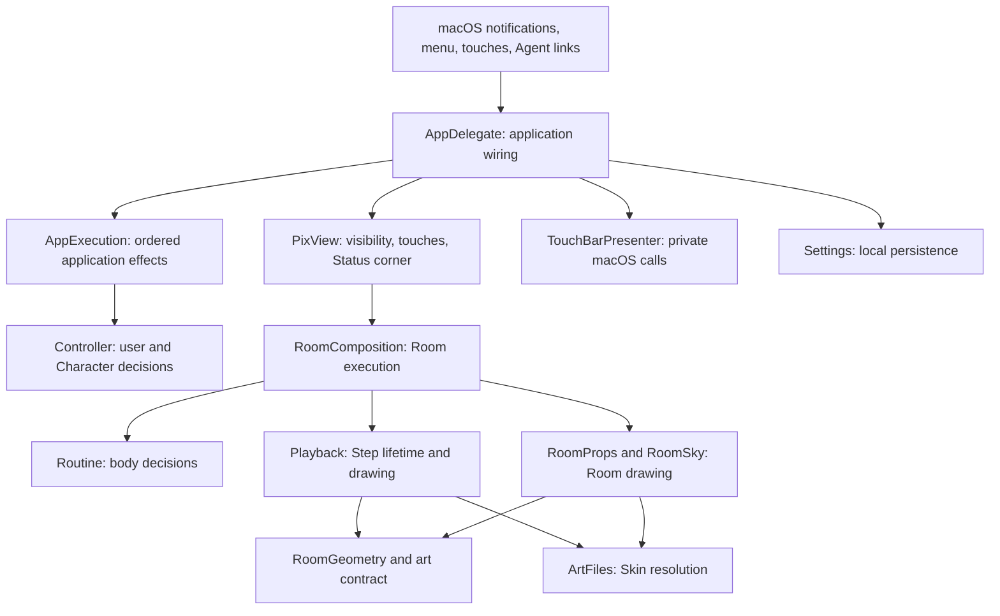

# Pix architecture

Pix grows by adding behavior to named owners behind small interfaces. The structure is an event-driven, deterministic core with a macOS execution and drawing shell. Keep the two existing package targets: `AmbientCore` and `Pix`.

This is the baseline for feature design and architecture reviews. It describes the current structure and the rules for extending it, rather than a refactoring backlog. Domain terms come from [CONTEXT.md](CONTEXT.md); recorded trade-offs live in `docs/adr/`.

## Dependency direction

The graph shows responsibility and dependency direction, not every call. `AmbientCore` contains Controller, Routine, their supporting rules, Looks, RoomGeometry and the art contract. It can use Foundation and CoreGraphics value types; it stays independent of AppKit, Core Animation, settings storage and private macOS calls. `Pix` depends on `AmbientCore`; the dependency never points back.

Controller and Routine are peers. Controller publishes Room and Moment values; application wiring passes them to the Room execution modules. Neither decision module calls into the other. Room execution reports Step completion to Routine; it does not report drawn coordinates back to Controller.

## Ownership map

An owner controls the state, rules and invariants in its row. Other modules request behavior or consume results through its interface. Shared knowledge of an ordering rule counts as part of that interface, even when Swift types do not express it.

| Owner | Owns | Receives or exposes |
| --- | --- | --- |
| Controller | Activity, Session, Mood, Focus session, Away, Agent working state, which Bar to show; coordination of Memory and Wardrobe | User/system Events and time → Room, Bar, optional Moment and Saved values |
| Memory | Remembering days, arrivals, Pets, completed Focus sessions and Occasions; selecting the special first Greeting | Domain facts and calendar → remembered values and Greeting choice |
| Wardrobe | Earned and worn Hats; choosing a Hat; delaying NEW HAT | Memory changes and Moment visibility → worn Hat and Moment choice |
| Routine | Where the Character goes and what it does next; priorities, interruption, return from Errands, queued Moments and Stroll progression | Routine Events and time → Step, Props, Garden and next wake deadline |
| Garden, Mug, Lamp, FidgetClock, WaitingMoments | Their own small sets of related state and rules | Routine supplies relevant facts; these modules hide their bookkeeping |
| RoomComposition | Sending Routine Events, sampling Room time, scheduling wakes, saving changed Garden, coordinating drawings and executing Steps | Room changes, Moments and lifecycle → coordinated Room execution |
| Playback | Executing a Step; movement, body and face, effects, cancellation, stale callbacks and exactly-once completion | Step, geometry, art and timing → drawings and completion |
| RoomProps / RoomSky | Stationary Prop drawings / sky conditions and visible sky life | Props or time/visibility/geometry → drawings; no Routine decisions |
| PixView | View attachment, size, build/teardown, touch interpretation, Clock and Caption drawings | Room, Moment and user choices → visible Room and touch callbacks |
| Art contract / RoomGeometry / ArtFiles | Valid drawings and placements / conversion into Room points / loading, caching and valid Skin-to-Classic fallback | Art facts and files → positions and resolved drawings |
| AppExecution | Applying Controller decisions in save, choices, render, Moment order; forced re-presentation | Controller Events and time → ordered application effects |
| AgentDelivery | Buffering launch-time Agent reports and choosing forwarding versus local delivery | Links and readiness → ordered Events or forwarded links |
| LoginItem / MacConditions | Login registration policy / translation of macOS power and thermal facts | Controlled effects or native facts → login changes and Controller values |
| AppDelegate / platform adapters | Launch, notifications and wiring / macOS presentation, storage and other external effects | Translate external facts into Events and apply decisions |

A module can be small and still provide depth: Lamp hides initialization and switching rules; Playback hides substantial completion and interruption knowledge. File length does not determine whether an owner should be split.

## Execution rules

1. **Decide before drawing.** Controller decides what the user’s day means; Routine decides what the Character does with its body. Drawing modules translate these values into art and motion. A drawing module does not choose a Fidget, satisfy a Need or award a Hat.
2. **Give mutable state one owner.** Persisted copies and drawing snapshots are projections of the owning module. For example, only Routine’s rules change the mug’s contents; RoomProps reads Props to show steam.
3. **Keep priorities together.** A new Care or Errand competes with existing Routine work through Routine’s decision flow. A new Controller reaction uses its existing decision flow. Independent feature timers must not compete to move the Character.
4. **Treat completion as a domain fact.** Routine advances after the current finite Step finishes. Playback rejects obsolete callbacks and completes once. Relook changes appearance while preserving the active Step’s lifetime. RoomComposition similarly rejects superseded wake callbacks.
5. **Keep effects with their execution owner.** Core decisions return values and deadlines. RoomComposition performs Room scheduling and Garden saving; Playback performs animation timing; Settings encodes local persistence. AppDelegate connects external facts to these owners.
6. **Preserve lifecycle meaning.** Being hidden or showing the Default bar is different from being Away. Rebuilding drawings is different from starting a new life: preserve the domain state that already survives rebuilding, and discard obsolete drawing work.
7. **Keep clocks with their decisions.** Controller and Room independently observe time, as recorded in ADR-0001. Within one Room event, RoomComposition shares one sampled time with Routine and time-dependent drawings. Hour rules remain with the behavior they govern.
8. **Keep drawing compatibility explicit.** The art contract is shared by generation, validation and execution. Skin resolution belongs to ArtFiles. Preserve existing Hat cell positions and fallback rules when extending the art.

## Where new work belongs

| Feature | Placement and change path |
| --- | --- |
| A static Prop | Extend the art contract and generated Room art. Add behavior only when the Prop actually does something. |
| A Prop with a Need and Care | Put Need state and rules beside Garden/Mug/Lamp, owned by Routine. Connect selection and completion in Routine, express appearance through Props, draw it in RoomProps, and persist through RoomComposition/Settings if it survives launch. |
| A new Errand or Fidget | Extend the Routine vocabulary and its selection/transition rules. Put placement in RoomGeometry and execution in Playback. Keep interruption and return policy with Routine. |
| A new Mood or Reaction | Put selection and priority in Controller, appearance in Looks/art, body execution in Playback. |
| A new Hat or Memory milestone | Put remembered facts in Memory, earning/wearing rules in Wardrobe/Hat, and drawings in the art contract and ArtFiles. |
| An Occasion | Extend the Occasion rules for Greetings and the season’s drawings in the relevant Room drawing module. Character movement still goes through Routine. |
| Another Agent tool | Translate its reports into the existing Agent Events. Keep anonymous identity, expiry and working-state rules in Controller; expand the domain vocabulary only for a genuinely new meaning. |
| A menu preference | Keep storage in Settings. Route behavior choices to their decision owner and drawing choices to their drawing owner. |
| Another display | Reuse Controller and Routine where their meanings hold. Add a display adapter and its geometry/execution as needed; extract shared drawing code only after seeing what both displays actually share. |

Changing several files for one feature is expected when the feature changes decisions, placement and art. Locality means each rule has one home; it does not require every feature to fit in one file.

## Growth triggers

Start from one Character and one continuous Room, as defined today. More Props, Errands, Moments and Agent tools fit this baseline without a new framework.

| Observed pressure | Architectural response |
| --- | --- |
| A caller must understand another owner’s bookkeeping | Move the invariant behind the existing interface; prefer deepening the owner before adding another module. |
| One domain concept’s changes repeatedly spread across unrelated cases | Consider a dedicated internal module with its own state and rules; keep coordination with the existing decision owner. |
| A second real external mechanism must vary independently | Put a seam at the variation and use concrete adapters. Existing live and controlled timing adapters are an example. |
| A second display has different execution requirements | Compare both implementations before choosing the shared seam. Keep rendering details out of AmbientCore. |
| Multiple Characters or independently evolving Rooms become a committed feature | Revisit state identity, ownership, persistence and scheduling before implementing it. This changes the current domain model. |

Use concrete modules until real variation justifies an adapter interface. Enums and explicit decisions are appropriate for the current closed set of behaviors. A generic behavior engine, plugin registry or extra package target needs evidence that the existing owners cannot express the required feature clearly.

## Verification at each seam

The interface is the test surface. Test observable decisions and effects with real collaborating modules wherever practical.

| Seam | Evidence required for changes there |
| --- | --- |
| Controller Events | Deterministic time and event sequences; resulting Bar/Room, Moment, Memory and Hat behavior. |
| Routine Events | Step and Props sequences, deadlines, interruption, return and completion. Keep supporting rule modules real in these tests. |
| Room execution | Real Routine and Playback with controlled time/timing effects; verify wake replacement, stale completions, rebuilds, Prop changes and changed Garden saves as relevant. |
| Playback | Real drawing state with controlled timing; verify completion, interruption and appearance without real sleeps. |
| Art and persistence | Real files or isolated storage, including old/missing/invalid data and fallback compatibility when formats change. |
| Application execution | Real Controller with controlled effects; save/choices/render/Moment order, unchanged writes, forced re-presentation and hidden Moments. |
| Platform integration | Controlled launch reports, login operations and power/thermal facts; live symbol resolution and missing-symbol cases. Real hardware still verifies visible presentation. |
| macOS presentation | Build and relevant view tests, plus hardware verification for behavior that depends on Touch Bar presentation. |

Add focused tests where they expose a rule the wider tests cannot express clearly. Moving an implementation inside an owner should preserve tests of that owner’s interface rather than require rewriting the suite around its new internals.

## When architecture work is justified

Before a feature, identify its decision owner, state owner, effect owner and relevant test seam using this guide. If those are clear, implement the feature there. Reuse existing owners before designing new abstractions.

A review recommendation must identify:

1. A violated ownership rule or concrete friction in a current or committed change.
2. The knowledge that leaks through the current interface, with source evidence.
3. The improvement in locality or leverage, and what tests demonstrate it.
4. Why the change is needed now rather than when that area next changes.

Apply the deletion test: a useful deep module hides complexity that would otherwise spread through callers. Removing a shallow pass-through may eliminate unnecessary complexity. Merely relocating the same knowledge does not earn a refactor.

**Completion criterion:** the requested behavior has clear owners, dependencies follow the intended direction, affected invariants are tested, and there is no demonstrated ownership conflict blocking the work. At that point, ship. A review may conclude that no architectural changes are needed.

RoomComposition applies frame-cap changes to everything that loops in the Room; drawing modules set the cap when they create an animation. Each PixView supplies one art source to its Room drawings and Status corner, including Classic Occasion art. PixView owns touch interpretation and deferred refresh; live and controlled timing exercise the same view interface. Settings supports isolated real defaults and Skin directories while retaining existing keys and formats.

Application execution was previously deferred. Verification work demonstrated the need to test ordering without launching Touch Bar presentation or changing login registration, so AppExecution, AgentDelivery and LoginItem now keep those rules behind controlled effects. They do not decide Room behavior or share the Controller and Room clocks. The monitor drawing move remains deferred until monitor feature work creates useful locality.

The finished bundle is verified for requested architectures, per-slice minimum macOS, signature and art. Hardware evidence remains separate; see docs/plan-touch-bar-compatibility.md. Optional opportunities remain optional; they are not prerequisites for adding the next feature. One is waiting for the next Control Strip change: TouchBarPresenter could keep the bar, the Pix button and its identifier itself, so AppDelegate stops passing the same pair into every show and hide.

Change this guide when a real requirement changes the ownership model. Record a consequential, surprising trade-off in an ADR when its reasoning would otherwise be lost. Architecture reviews should check this baseline and those decisions before proposing a different structure.
